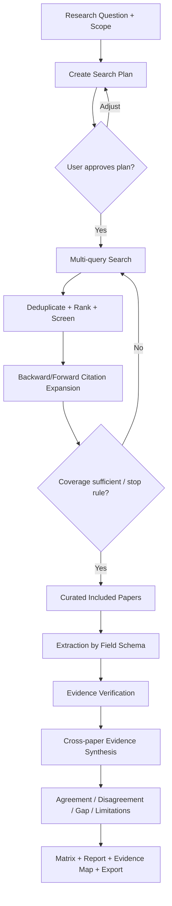
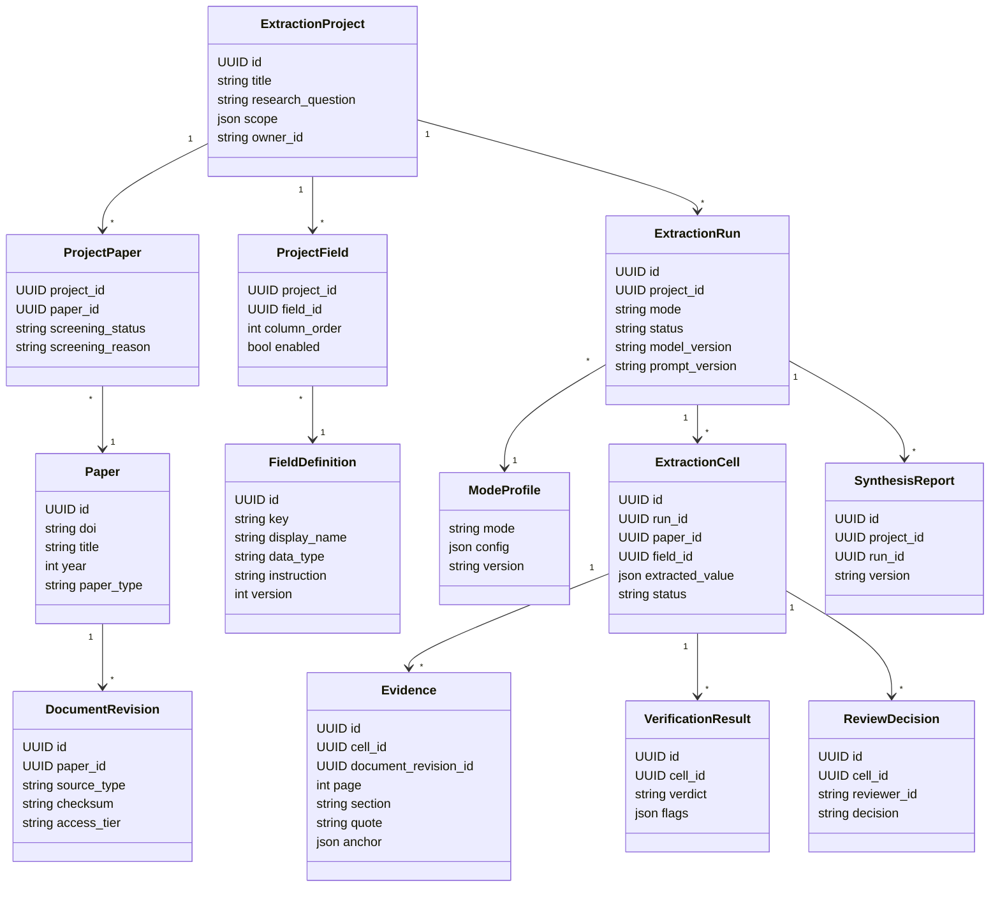

# PRODUCT REQUIREMENTS DOCUMENT (PRD)

# Paper Extraction & Comparative Research Matrix

**Reference UX:** SciSpace Literature Review / Data Extractor  
**Product:** Paper Understanding — Paper Extraction Module  
**Document Version:** 1.0  
**Date:** 10/11/2026  
**Status:** Proposed / Ready for product & engineering review  
**Language:** Vietnamese (UI hỗ trợ Việt/Anh; tên trường extraction giữ tiếng Anh)

---

## 0. Executive Summary

Phát triển chức năng **Paper Extraction** theo trải nghiệm tham chiếu của SciSpace: mỗi **hàng = một paper**, mỗi **cột = một trường thông tin cần trích xuất**, mỗi **ô = kết quả AI được gắn bằng chứng**. Người dùng có thể tạo/cấu hình cột, chạy AI theo lô, lọc/so sánh các paper, kiểm chứng nguồn, chỉnh sửa kết quả và xuất dữ liệu.

Hệ thống cung cấp **ba chế độ thực thi**:

- **Standard:** extraction nhanh theo một lần xử lý chính; ưu tiên tốc độ/chi phí.
- **High Quality:** extraction có kiểm chứng lại theo evidence và xử lý trường hợp mâu thuẫn; ưu tiên chất lượng trên từng paper.
- **Deep Research:** tìm kiếm/phát hiện tài liệu đa vòng (nếu được bật), mở rộng nguồn có kiểm soát, extraction có chứng cứ và **tổng hợp liên paper** theo câu hỏi nghiên cứu.

> **Phân định quan trọng:** SciSpace quảng bá Standard, High Quality và **Deep Review** chủ yếu như _các mức Literature Review_. Trong tài liệu và các giao diện, thuật ngữ **Deep Research** cũng có thể xuất hiện cho công cụ/tác vụ nghiên cứu sâu. PRD này dùng nhãn **Deep Research** theo yêu cầu sản phẩm, ánh xạ ý tưởng từ Deep Review; quy trình extraction/verification cụ thể dưới đây là **thiết kế của hệ thống mới**, không khẳng định là thuật toán nội bộ SciSpace. Các mức số lượng bài báo được công bố trong các bài hướng dẫn SciSpace khác nhau; **không hard-code** chúng làm đặc tả sản phẩm.

**Kết quả nghiệp vụ mong đợi:** một _Evidence-backed Extraction Matrix_ có thể kiểm toán, tái chạy, so sánh và tái sử dụng cho Paper Understanding / Literature Review / Research Design.

## 1. Context, Problem, Opportunity

### 1.1. Context

- Nhà nghiên cứu xử lý hàng chục đến hàng trăm paper với cấu trúc và cách diễn đạt không đồng nhất.
- Trích xuất thủ công các trường như Objectives, Method, Dataset, Metrics, Results, Limitations và Research Gap mất thời gian; cùng một trường thường được mô tả ở nhiều section khác nhau.
- Các bảng tổng hợp AI nếu không chỉ ra passage/page/section gốc khó được thẩm định và dễ tạo ra kết luận thiếu chứng cứ.
- Nhu cầu mở rộng từ tóm tắt từng paper sang **so sánh liên paper**, nhất là methods, evaluation protocols, baselines, threats to validity và claims/evidence.

### 1.2. Problems

| ID   | Vấn đề                                               | Tác động                               |
| ---- | ---------------------------------------------------- | -------------------------------------- |
| P-01 | Không có schema extraction dùng chung cho bộ paper   | Khó so sánh nhất quán                  |
| P-02 | AI suy luận khi paper không cung cấp thông tin       | Hallucination, giảm độ tin cậy         |
| P-03 | Kết quả không gắn đoạn nguồn và phiên bản paper      | Khó kiểm chứng/khó truy vết            |
| P-04 | Một cấu hình extraction áp cho mọi loại paper        | Trường không phù hợp, lãng phí chi phí |
| P-05 | Không phân biệt trích xuất từ abstract hay full text | Người dùng hiểu nhầm độ tin cậy        |
| P-06 | Khó mở rộng từ một paper sang nhiều paper            | Thiếu evidence synthesis có cấu trúc   |

## 2. Goals / Non-goals

### 2.1. Goals (G)

| ID   | Goal                                                     | Measurement (mục tiêu kiểm thử đề xuất)                     |
| ---- | -------------------------------------------------------- | ----------------------------------------------------------- |
| G-01 | Tạo và lưu extraction matrix đa paper/đa field           | Tạo, chỉnh và reload project không mất state                |
| G-02 | Field catalog + custom fields theo instruction           | Tạo/reorder/duplicate/version field hoạt động               |
| G-03 | Mọi assertion quan trọng có evidence truy ngược          | ≥ 98% evidence links của bộ test mở đúng nguồn/đoạn         |
| G-04 | Phân biệt Missing/Not applicable/Not found/Contradictory | 100% trạng thái được lưu tách biệt, không tự điền           |
| G-05 | Hỗ trợ Standard / High Quality / Deep Research           | E2E cho cả 3 chế độ, không dùng chung một pipeline giả danh |
| G-06 | Xuất dữ liệu có nguồn và metadata                        | CSV/XLSX/JSON; export evidence riêng                        |
| G-07 | Người đánh giá có thể xác minh/sửa ô                     | Audit log trước/sau và reviewer được giữ                    |
| G-08 | Chi phí và phạm vi chạy kiểm soát được                   | Hiển thị dự toán, số paper/field, tiến độ, lỗi, hủy         |

**Các ngưỡng G-03 và các ngưỡng QA tiếp theo là tiêu chí nghiệm thu sản phẩm đề xuất, không phải số liệu được SciSpace công bố.**

### 2.2. Non-goals (v1)

- Không cam kết tự động tạo ra _Systematic Literature Review_ hoàn chỉnh đúng chuẩn PRISMA chỉ từ một prompt.
- Không tự xác nhận kết quả thống kê hoặc tái thực nghiệm thay tác giả.
- Không tự truy cập trái phép PDF paywall, không vượt quyền truy cập tài liệu.
- Không triển khai toàn bộ Paper Writing, Citation Manager hay Scientific Measurement Intelligence Platform (SMIP) trong module này.
- Không coi «research gap do AI nêu» là đóng góp khoa học được xác nhận nếu chưa kiểm chứng.

## 3. Product Principles

1. **Evidence first:** Mọi extraction có thể truy về đoạn nguồn; nếu thiếu chứng cứ, trả trạng thái thiếu.
2. **Source fidelity:** Phân biệt dữ liệu tác giả báo cáo với suy luận/tổng hợp của AI.
3. **Field consistency:** Một field có định nghĩa, kiểu dữ liệu, instruction và quy tắc validation thống nhất.
4. **Mode transparency:** User biết đang chạy chế độ nào, số vòng xử lý, nguồn và mức kiểm chứng.
5. **Human-in-the-loop:** AI hỗ trợ, người nghiên cứu quyết định inclusion, sửa và duyệt kết quả.
6. **Reproducibility:** Ghi model version, prompt version, document revision và thời điểm chạy.

## 4. User Personas & Jobs-to-be-Done

| Persona                  | JTBD                                       | Kết quả mong đợi                          |
| ------------------------ | ------------------------------------------ | ----------------------------------------- |
| Researcher / PhD student | So sánh 30 paper theo method, metrics, gap | Matrix và nguồn dẫn có thể xác minh       |
| SLR reviewer             | Thu thập bằng chứng theo schema cố định    | Export, quyết định inclusion, audit trail |
| Research supervisor      | Kiểm tra claims, metrics và hạn chế paper  | Evidence viewer + verification            |
| Research assistant       | Chạy batch và xử lý lỗi/ô còn trống        | Retry, bulk review, progress              |
| Product admin            | Quản lý field catalog và chất lượng AI     | Template, policy, cost, monitoring        |

## 5. Information Architecture & Main Screens

```text
Paper Understanding
└── Extraction Workspaces
    ├── Workspace List
    └── Extraction Project
        ├── Query / Research Scope / Inclusion Rules
        ├── Mode Selector: Standard | High Quality | Deep Research
        ├── Papers: Search, Import, Upload, Screen, Select
        ├── Extraction Matrix [papers x fields]
        │   ├── Suggested Columns
        │   ├── Custom Columns / Column Templates
        │   ├── Cell Preview & Evidence Drawer
        │   └── Filter / Sort / Group / Compare
        ├── Jobs / Progress / Run History
        ├── Evidence Review / Human Validation
        ├── Cross-paper Synthesis (Deep Research)
        └── Export / Save Snapshot / Audit Trail
```

### 5.1. Matrix Layout (tham chiếu SciSpace)

- Cột cố định bên trái: chọn paper, Title, Authors, Year, DOI, Journal/Venue, nguồn full text/abstract.
- Các cột bên phải: `Insights`, `TL;DR`, `Objectives`, `Methods Used`, ...; hỗ trợ kéo ngang, pin/reorder/ẩn/hiện.
- Mỗi ô hiển thị giá trị đã rút gọn + badge trạng thái (Verified / Needs review / Not found / No full text).
- Click ô mở **Evidence Drawer**: extracted value, raw excerpt, source section, page, location, DOI/PDF, confidence, reasoning note, lịch sử sửa và nút Approve/Edit/Reject/Rerun.
- Menu `+ Add Column`: Suggested Fields / Custom Field / Import Field Template.
- Toolbar: `Run Extraction`, chọn mode, chỉ định paper/fields, filter, progress, export.
- Deep Research có thêm các tab `Search Plan`, `Source Discovery`, `Coverage`, `Synthesis`, `Contradictions`.

## 6. Operational Modes — KEY REQUIREMENT

### 6.1. Mode comparison

| Dimension                | Standard                              | High Quality                                         | Deep Research                                                      |
| ------------------------ | ------------------------------------- | ---------------------------------------------------- | ------------------------------------------------------------------ |
| Primary goal             | Tốc độ và chi phí thấp                | Độ chính xác ở paper level                           | Khám phá và tổng hợp liên paper                                    |
| Starting input           | Paper set / query                     | Paper set / query                                    | Research Question + scope, seed papers tùy chọn                    |
| Discovery                | Search cơ bản hoặc dùng paper đã chọn | Search có lọc/curation hoặc dùng paper đã chọn       | Multi-query, iterative discovery, citation chaining khi có dữ liệu |
| Extraction               | Một lượt chính + schema checks        | Lượt chính + evidence verification + selective retry | Extraction theo lô + evidence consolidation                        |
| Cross-paper synthesis    | Không bắt buộc                        | Basic compare                                        | Bắt buộc có synthesis và đối chiếu khác biệt                       |
| Evidence                 | Passage khi có dữ liệu                | Passage/page/section; kiểm tra source-claim          | Multi-paper evidence map, provenance                               |
| User checkpoint          | Xem kết quả                           | Review ambiguous cells                               | Phê duyệt scope/search plan và screening trước tổng hợp            |
| Output                   | Extraction Matrix                     | Verified Extraction Matrix                           | Matrix + Source Map + Synthesis Report                             |
| Performance/cost profile | Ưu tiên nhanh/rẻ                      | Tốn tài nguyên hơn                                   | Tốn tài nguyên nhất, nhiều công đoạn                               |

**Không nhầm lẫn:** `High Quality` không có nghĩa là lấy nhiều bài báo hơn một cách bắt buộc; mô hình cốt lõi là mức độ xác minh và chất lượng output. `Deep Research` không phải đơn thuần cho phép tăng số paper: nó phải có workflow khám phá/tổng hợp khác Standard.

### 6.2. Standard workflow

1. User tạo Project, import hoặc search paper, chọn các fields.
2. Hệ thống kiểm tra access: Full Text / Abstract Only / Metadata Only.
3. Extract từng field từ nội dung sẵn có, chuẩn hóa output theo schema.
4. Chạy automated structural validation: type, required keys, evidence path có tồn tại.
5. Xuất Matrix; ô thiếu chứng cứ là `NOT_FOUND` hoặc `INSUFFICIENT_SOURCE`, **không đoán**.

**Outputs:** `ExtractionRun`, `ExtractionCell[]`, `Evidence[]`, `MatrixSnapshot`.

### 6.3. High Quality workflow

1. Chạy Standard extraction như tầng đầu.
2. Evidence verifier đối chiếu giá trị với các đoạn nguồn, kiểm tra entailed/not entailed/contradicted.
3. Nếu ô mơ hồ: truy xuất lại đoạn liên quan, chạy prompt trích xuất chuyên biệt cho field đó.
4. Nếu nhiều passage mâu thuẫn: hiển thị `CONFLICT` và cả hai evidence; **không tự chọn một kết luận chắc chắn**.
5. QC pass: source confidence, source coverage, completeness, field-specific validation.
6. Đánh dấu `NEEDS_REVIEW` nếu verifier chưa thể xác minh; người dùng có thể Approve.

**Outputs bổ sung:** `VerificationResult`, `QualityFlags`, `ReviewerDecisions`.

### 6.4. Deep Research workflow



- Search plan gồm: RQ, concepts, synonyms, inclusion/exclusion, năm, domain, loại publication, search providers, expansion depth, stop rules.
- Agent đề xuất nhiều query, nhưng **hiển thị rõ từng query** và nguồn, tránh «black-box discovery».
- Dedup ưu tiên DOI; khi thiếu DOI dùng title normalization + authors/year + similarity, user xác nhận những trường hợp nghi ngờ.
- Citation expansion chỉ thực hiện khi provider có dữ liệu citation graph; ghi rõ missing edges.
- Screening: `Candidate → Included / Excluded / Uncertain`; ghi reason.
- Chỉ các included papers mới được đưa vào synthesis chính; excluded có thể lưu vì audit.
- Synthesis phải dẫn danh sách paper/evidence cho mỗi claim; nêu contradictory findings, subgroup differences, heterogeneity và evidence limitations.
- **Research Gap** được trình bày là _candidate gap/hypothesis_, kèm căn cứ và mức độ phủ nguồn; không kết luận «chưa từng có nghiên cứu» chỉ từ tập tìm kiếm hạn chế.

### 6.5. Configuration & Budget Policy

- Không gắn ba chế độ với con số SciSpace cố định; các tài liệu công khai của chính SciSpace đưa ra quy mô paper khác nhau ở các thời điểm.
- Mỗi mode có `ModeProfile` cấu hình: `max_candidate_papers`, `max_included_papers`, `max_fields`, `verification_passes`, `citation_depth`, `max_search_iterations`, `max_cost`, `deadline`, `model_routing`, `max_retries`.
- **Targets đề xuất cho pilot, không phải con số SciSpace:** Standard ≤ 25 paper/run; High Quality ≤ 25 paper/run; Deep Research ≤ 100 included papers/project, xử lý theo batches; UI catalog 50 columns/project. Có thể tăng cấu hình sau benchmark.
- Trước khi chạy hiển thị dự toán tài nguyên (paper count × field count × passes); user xác nhận nếu vượt ngân sách cấu hình.
- Sau khi chạy lưu actual usage, retries và errors để cải thiện profile.

## 7. Functional Requirements

### 7.1. Project & Paper Management

| ID     | Requirement                                              | Priority             | Acceptance Criteria                                              |
| ------ | -------------------------------------------------------- | -------------------- | ---------------------------------------------------------------- |
| FR-001 | Create/Rename/Archive Extraction Project                 | Must                 | Có project ID, owner, scope, timestamps; lưu và reload           |
| FR-002 | Add papers bằng DOI, URL, BibTeX/RIS, search, PDF upload | Must                 | Metadata được chuẩn hóa; hỗ trợ trường thiếu                     |
| FR-003 | Deduplicate paper                                        | Must                 | Exact DOI + fuzzy candidates; merge có audit                     |
| FR-004 | Source access type                                       | Must                 | Mỗi paper gắn Full Text / Abstract / Metadata và provenance      |
| FR-005 | Search + filters                                         | Should               | Year, author, venue, type, keyword, full text; có thể lưu search |
| FR-006 | Inclusion/exclusion decision                             | Must (Deep Research) | Có reviewer, reason, timestamp; lọc included                     |
| FR-007 | Version the source document                              | Must                 | Thay PDF tạo revision, flag kết quả cũ stale                     |

### 7.2. Field Catalog & Custom Fields

| ID     | Requirement                         | Priority | Acceptance Criteria                                                 |
| ------ | ----------------------------------- | -------- | ------------------------------------------------------------------- |
| FR-010 | Suggested field catalog             | Must     | Cột có key, label, description, data type, instruction, version     |
| FR-011 | Add/Reorder/Hide/Pin/Remove columns | Must     | Matrix phản ánh lựa chọn; không xóa data khi hide                   |
| FR-012 | Create custom column                | Must     | Có name, instruction (optional), type, scope, validation            |
| FR-013 | Field versioning                    | Must     | Sửa instruction tạo version; historical output giữ field version    |
| FR-014 | Field templates by research type    | Should   | Experimental, SLR, Survey, Theoretical + tùy chỉnh                  |
| FR-015 | Dependency / derived field          | Could    | Có field tổng hợp dựa trên các output khác, ghi lineage             |
| FR-016 | Bulk rerun selected columns         | Must     | Chạy lại chỉ các cells cần cập nhật, không ghi đè verified mặc định |

**Field schema** (tối thiểu):

```json
{
  "field_key": "evaluation_metrics",
  "display_name": "Evaluation Metrics",
  "description": "Metrics explicitly used to evaluate the method",
  "data_type": "list<object>",
  "extraction_instruction": "Extract the metric name, definition, unit, and where reported. Do not infer metrics not explicitly reported.",
  "allowed_source_scope": ["full_text", "abstract"],
  "applicable_study_types": ["experimental", "empirical"],
  "required_evidence": true,
  "normalization_rules": ["preserve_original_name", "normalize_unit_if_explicit"],
  "version": 1
}
```

### 7.3. AI Extraction Engine

| ID     | Requirement                        | Priority       | Acceptance Criteria                                              |
| ------ | ---------------------------------- | -------------- | ---------------------------------------------------------------- |
| FR-020 | Batch extraction                   | Must           | Chạy selected papers × selected fields; có progress/cancel/retry |
| FR-021 | Select execution mode              | Must           | 3 mode dẫn tới pipeline và outputs tương ứng                     |
| FR-022 | Source-aware context               | Must           | Truy hồi passage từ đúng source revision, lưu source tier        |
| FR-023 | Structured JSON outputs            | Must           | Mọi ô parse được về schema; type validation                      |
| FR-024 | Explicit missingness               | Must           | Missing ≠ not applicable ≠ unsupported ≠ failed                  |
| FR-025 | Detect conflicting statements      | Should         | Có 2 evidence trái ngược, đánh dấu conflict                      |
| FR-026 | Evidence grounding                 | Must           | Giá trị đi kèm source page/section/passage khi có                |
| FR-027 | Multi-pass verification            | Must (HQ/Deep) | Truy vết verification pass và kết quả                            |
| FR-028 | Idempotent retries                 | Must           | Retry một job không sinh ô trùng hoặc mất approval               |
| FR-029 | Re-extract on source/field updates | Must           | Ô stale được hiển thị và chạy lại có kiểm soát                   |

### 7.4. Evidence Viewer & Human Review

| ID     | Requirement                       | Priority | Acceptance Criteria                                      |
| ------ | --------------------------------- | -------- | -------------------------------------------------------- |
| FR-030 | Open source evidence from cell    | Must     | Jump đến PDF page và highlight region hoặc text excerpt  |
| FR-031 | Review/Edit/Approve/Reject        | Must     | Giữ AI original, human current value, reviewer history   |
| FR-032 | Assign quality flags              | Must     | Unsupported, Ambiguous, Conflicting, Low source coverage |
| FR-033 | Filter unresolved cells           | Must     | Lọc tất cả ô cần duyệt theo paper, field, mode           |
| FR-034 | Side-by-side source vs value      | Should   | UI hỗ trợ người đánh giá quyết định nhanh                |
| FR-035 | Bulk approve only with guardrails | Should   | Không cho bulk approve cells unsupported/failed          |

### 7.5. Cross-paper Synthesis (Deep Research)

| ID     | Requirement                     | Priority                     | Acceptance Criteria                                      |
| ------ | ------------------------------- | ---------------------------- | -------------------------------------------------------- |
| FR-040 | Multi-query search plan         | Must                         | Xem query, nguồn, filter, vòng tìm kiếm                  |
| FR-041 | Citation expansion & provenance | Must where provider supports | Từng edge có nguồn dữ liệu; missing được ghi nhận        |
| FR-042 | Evidence grouping               | Must                         | Group theo themes/methods/datasets/metrics               |
| FR-043 | Agreement/disagreement matrix   | Must                         | Claim gắn supporting/contradicting studies               |
| FR-044 | Candidate gap report            | Must                         | Mỗi gap có evidence, caveat, coverage và reviewer status |
| FR-045 | Structured synthesis report     | Must                         | Có methods, trends, gap, limitations, references         |
| FR-046 | Report regeneration             | Should                       | Không tự sửa approved matrix; version report mới         |

### 7.6. Export & Integrations

| ID     | Requirement                 | Priority | Acceptance Criteria                                     |
| ------ | --------------------------- | -------- | ------------------------------------------------------- |
| FR-050 | Export CSV + XLSX matrix    | Must     | Hàng/cột đúng lựa chọn; giá trị và status tách biệt     |
| FR-051 | Export JSON evidence-backed | Must     | Bao gồm cell, source, evidence, provenance              |
| FR-052 | Export Markdown report      | Must     | Deep Research report có references + links              |
| FR-053 | Export BibTeX/RIS citations | Should   | Có các paper đã chọn và citation metadata               |
| FR-054 | Save Matrix Snapshot        | Must     | Xem lại ảnh chụp trạng thái theo thời gian              |
| FR-055 | External-module API         | Should   | Paper Understanding và Research Design đọc được dữ liệu |

## 8. Field Catalog (50 recommended fields)

> **Nguồn của catalog:** 16 trường đầu gồm `Insights` và 15 cột gợi ý **quan sát được trên ảnh SciSpace do người dùng cung cấp**. Các trường từ #17–22 được giữ theo danh sách tham chiếu đã thảo luận; không coi là xác nhận rằng chúng đều là cột preset chính thức ở mọi tài khoản/phiên bản SciSpace. Các trường #23–50 là **mở rộng cho sản phẩm Paper Understanding**. Catalog toàn bộ 50 fields là **đề xuất của PRD**, không phải bản chụp đầy đủ preset chính thức của SciSpace.

|   # | Field Key               | Column Name              | Group               | Default priority | Origin              |
| --: | ----------------------- | ------------------------ | ------------------- | ---------------- | ------------------- |
|   1 | insights                | Insights                 | Summary             | P1               | Screenshot          |
|   2 | tldr                    | TL;DR                    | Summary             | P1               | Screenshot          |
|   3 | conclusions             | Conclusions              | Summary             | P1               | Screenshot          |
|   4 | summarized_abstract     | Summarized Abstract      | Summary             | P1               | Screenshot          |
|   5 | results                 | Results                  | Results             | P1               | Screenshot          |
|   6 | summarized_introduction | Summarized Introduction  | Background          | P2               | Screenshot          |
|   7 | methods_used            | Methods Used             | Methodology         | P1               | Screenshot          |
|   8 | literature_survey       | Literature Survey        | Related work        | P2               | Screenshot          |
|   9 | limitations             | Limitations              | Critical analysis   | P1               | Screenshot          |
|  10 | contributions           | Contributions            | Contribution        | P1               | Screenshot          |
|  11 | practical_implications  | Practical Implications   | Impact              | P2               | Screenshot          |
|  12 | objectives              | Objectives               | Research design     | P1               | Screenshot          |
|  13 | findings                | Findings                 | Results             | P1               | Screenshot          |
|  14 | research_gap            | Research Gap             | Research design     | P1               | Screenshot          |
|  15 | future_research         | Future Research          | Future work         | P1               | Screenshot          |
|  16 | dependent_variables     | Dependent Variables      | Variables           | P2               | Screenshot          |
|  17 | independent_variables   | Independent Variables    | Variables           | P2               | Reference extension |
|  18 | dataset                 | Dataset                  | Experimental design | P1               | Reference extension |
|  19 | population_sample       | Population Sample        | Experimental design | P2               | Reference extension |
|  20 | problem_statement       | Problem Statement        | Research design     | P1               | Reference extension |
|  21 | challenges              | Challenges               | Problem analysis    | P2               | Reference extension |
|  22 | applications            | Applications             | Applications        | P2               | Reference extension |
|  23 | research_questions      | Research Questions       | Research design     | P1               | Proposed extension  |
|  24 | hypotheses              | Hypotheses               | Research design     | P2               | Proposed extension  |
|  25 | theoretical_framework   | Theoretical Framework    | Research design     | P2               | Proposed extension  |
|  26 | research_approach       | Research Approach        | Methodology         | P1               | Proposed extension  |
|  27 | proposed_method_model   | Proposed Method / Model  | Methodology         | P1               | Proposed extension  |
|  28 | system_architecture     | System Architecture      | Methodology         | P2               | Proposed extension  |
|  29 | algorithms_used         | Algorithms Used          | Methodology         | P2               | Proposed extension  |
|  30 | experimental_setup      | Experimental Setup       | Experiment          | P1               | Proposed extension  |
|  31 | experimental_protocol   | Experimental Protocol    | Experiment          | P1               | Proposed extension  |
|  32 | evaluation_metrics      | Evaluation Metrics       | Measurement         | P1               | Proposed extension  |
|  33 | measurement_methods     | Measurement Methods      | Measurement         | P1               | Proposed extension  |
|  34 | baseline_methods        | Baseline Methods         | Evaluation          | P1               | Proposed extension  |
|  35 | comparison_methods      | Comparison Methods       | Evaluation          | P2               | Proposed extension  |
|  36 | statistical_tests       | Statistical Tests        | Evaluation          | P2               | Proposed extension  |
|  37 | quantitative_results    | Quantitative Results     | Results             | P1               | Proposed extension  |
|  38 | qualitative_results     | Qualitative Results      | Results             | P2               | Proposed extension  |
|  39 | effect_size             | Effect Size              | Evaluation          | P2               | Proposed extension  |
|  40 | ablation_study          | Ablation Study           | Evaluation          | P2               | Proposed extension  |
|  41 | sensitivity_analysis    | Sensitivity Analysis     | Evaluation          | P2               | Proposed extension  |
|  42 | threats_to_validity     | Threats to Validity      | Critical analysis   | P1               | Proposed extension  |
|  43 | reproducibility         | Reproducibility          | Research quality    | P2               | Proposed extension  |
|  44 | source_code_repository  | Source Code / Repository | Research assets     | P2               | Proposed extension  |
|  45 | data_availability       | Data Availability        | Research assets     | P2               | Proposed extension  |
|  46 | key_claims              | Key Claims               | Scientific argument | P1               | Proposed extension  |
|  47 | supporting_evidence     | Supporting Evidence      | Scientific argument | P1               | Proposed extension  |
|  48 | assumptions             | Assumptions              | Scientific argument | P2               | Proposed extension  |
|  49 | contradictory_evidence  | Contradictory Evidence   | Scientific argument | P3               | Proposed extension  |
|  50 | research_novelty        | Research Novelty         | Contribution        | P1               | Proposed extension  |

### 8.1. Recommended Field Templates

| Paper Type              | Default template                                                                                                     | Optional fields                                      |
| ----------------------- | -------------------------------------------------------------------------------------------------------------------- | ---------------------------------------------------- |
| Experimental/Empirical  | Objectives, Methods Used, Dataset, Experimental Setup, Protocol, Evaluation Metrics, Baselines, Results, Limitations | Hypotheses, Effect Size, Statistical Tests, Ablation |
| SLR/Systematic Review   | RQ, Literature Survey, Search Strategy*, Inclusion/Exclusion*, Findings, Research Gap, Limitations                   | Risk of Bias*, Synthesis Method*, PRISMA Flow*       |
| Survey/Narrative Review | Objectives, Taxonomy*, Literature Survey, Challenges, Trends*, Research Gap                                          | Applications, Future Research                        |
| Theoretical/Conceptual  | Problem Statement, Theoretical Framework, Assumptions, Proposed Method, Contributions                                | Proof/Argument Structure*, Limitations               |
| System/Architecture     | Objectives, Architecture, Algorithms, Metrics, Experimental Setup, Results, Reproducibility                          | Performance, Scalability*, Resource Consumption*     |

`*` = custom fields bổ sung theo template, **không nằm trong 50 field mặc định**. UI phải hỗ trợ không giới hạn logic catalog nội bộ; giới hạn số cột hiển thị/chạy được cấu hình riêng.

### 8.2. Field instruction rules

- `Objective`: Chỉ trích xuất mục tiêu được nêu hoặc suy ra rất sát nội dung; nếu suy luận phải gắn `inferred=true` và review.
- `Research Gap`: Tách `gap_claimed_by_authors` và `gap_identified_by_synthesis` để tránh đánh tráo quan điểm.
- `Evaluation Metrics`: Chỉ ghi metric dùng trong đánh giá, không nhầm với thuật toán, benchmark hay dataset.
- `Experimental Protocol`: Ghi split, repetitions, parameter setting, environment, statistical procedure; trường thiếu đánh dấu unknown.
- `Results`: Giữ chính xác số liệu và đơn vị; gắn metric, baseline, dataset, experimental setting.
- `Methods Used`: Phân biệt `proposed` và `baseline`, `used` và `discussed`.
- `Limitations`: Phân biệt author-declared limitation và reviewer-inferred limitation.
- `Key Claims`: Không tạo claim mạnh hơn bằng chứng của paper.

## 9. Data Model (Logical)



### 9.1. Extraction cell contract

```json
{
  "cell_id": "uuid",
  "paper_id": "uuid",
  "field_key": "evaluation_metrics",
  "field_version": 1,
  "run_id": "uuid",
  "mode": "HIGH_QUALITY",
  "value": [
    {
      "name": "F1-score",
      "definition": null,
      "unit": "score",
      "reported_value": 0.91,
      "context": "test dataset"
    }
  ],
  "status": "NEEDS_REVIEW",
  "source_access": "FULL_TEXT",
  "assertion_type": "AUTHOR_REPORTED",
  "evidence_ids": ["ev-01"],
  "quality_flags": ["AMBIGUOUS_METRIC_AGGREGATION"],
  "confidence": { "label": "MEDIUM", "calibrated_probability": null },
  "verified_by": null,
  "created_at": "2026-11-10T00:00:00Z"
}
```

**Điểm cốt lõi:** `confidence.label` chỉ là heuristic trừ khi đã có calibration với gold dataset. Không diễn giải nó như xác suất đúng nếu chưa được kiểm định.

### 9.2. Evidence contract

```json
{
  "evidence_id": "ev-01",
  "document_revision_id": "rev-01",
  "source_access": "FULL_TEXT",
  "page": 8,
  "section": "Evaluation",
  "quote": "<verbatim excerpt from the user's legitimately accessed source>",
  "char_start": 3142,
  "char_end": 3224,
  "bounding_boxes": [],
  "supports": ["cell-id"],
  "stance": "SUPPORTS",
  "extraction_method": "PDF_TEXT",
  "verified": false
}
```

Evidence anchor là **trỏ về văn bản/bounding box**; nếu chỉ có abstract thì `page=null`, `source_access=ABSTRACT_ONLY` và UI phải hiển thị rõ.

## 10. Status & State Machine

### 10.1. Paper screening

`DISCOVERED → SCREENING → INCLUDED | EXCLUDED | UNCERTAIN`

### 10.2. Run

`DRAFT → QUEUED → RUNNING → COMPLETED | PARTIAL | FAILED | CANCELLED`

### 10.3. Cell

| Status              | Definition                                                               | UI behaviour                     |
| ------------------- | ------------------------------------------------------------------------ | -------------------------------- |
| NOT_RUN             | Chưa chạy extraction                                                     | Run                              |
| QUEUED              | Đã xếp hàng                                                              | Queue indicator                  |
| RUNNING             | Đang xử lý                                                               | Progress                         |
| EXTRACTED           | AI có kết quả, chưa reviewer duyệt                                       | Open evidence                    |
| NEEDS_REVIEW        | Evidence mơ hồ/validation chưa qua                                       | Prioritize review                |
| VERIFIED            | Reviewer phê duyệt hoặc chính sách auto-verification đã được xác định rõ | Lock original version            |
| NOT_FOUND           | Paper không nêu thông tin trong phần đã truy cập                         | Không biến thành NULL vô nghĩa   |
| NOT_APPLICABLE      | Trường không áp dụng cho paper                                           | Không coi là extraction thất bại |
| INSUFFICIENT_SOURCE | Không đủ abstract/full text để xác định                                  | Request PDF / expand access      |
| CONFLICT            | Các đoạn nguồn mâu thuẫn                                                 | Show all evidence                |
| STALE               | Source/field definition đổi sau extraction                               | Rerun suggested                  |
| FAILED              | Lỗi model/parser/tool                                                    | Retry + error log                |

`VERIFIED` luôn lưu `verification_type = HUMAN | AUTOMATED`, không đánh đồng review bằng người và qua rule AI.

## 11. Technical & AI Design Requirements (Solution Constraints, not fixed implementation)

### 11.1. Proposed pipeline

```text
Paper sources (DOI / Search Providers / Uploaded PDF)
  → Metadata normalization & dedup
  → PDF/text ingestion & section parsing
  → Source-aware indexing (paper/revision/page/section anchors)
  → Field-aware retrieval
  → Structured extraction
  → (HQ/Deep) Evidence verification & selective retry
  → Cell persistence & review
  → (Deep) Cross-paper synthesis
  → Export & APIs
```

- Metadata connectors có thể dùng OpenAlex/Crossref/Semantic Scholar theo license và quota của từng provider; không giả định tất cả đều cung cấp PDF.
- Các tài liệu không có full text phải được xử lý ở mức abstract-only, không tự xây dựng «full-text extraction» từ metadata.
- Cần giữ nguyên nội dung excerpt theo nguồn, không sửa câu gốc để khớp kết luận AI.
- Tránh context stuffing toàn bộ 100 paper vào một prompt; áp dụng batch/map-reduce/hierarchical synthesis và citations theo paper.
- Prompt injection/hidden instructions trong PDF phải bị xem là **dữ liệu không tin cậy**, không được điều khiển pipeline/tool/action.
- Parse bảng, phương trình, đồ thị chỉ ở mức kỹ thuật cho phép; nếu chưa hỗ trợ, flag `UNPARSEABLE_TABLE_OR_FIGURE`.

### 11.2. Source coverage / confidence

Quality metadata tối thiểu:

- `source_access`: FULL_TEXT / ABSTRACT_ONLY / METADATA_ONLY
- `extracted_from`: ABSTRACT / INTRODUCTION / METHODS / RESULTS / DISCUSSION / OTHER
- `evidence_status`: DIRECT / PARTIAL / INFERRED / NONE
- `verification_verdict`: SUPPORTED / PARTIALLY_SUPPORTED / CONTRADICTED / INDETERMINATE
- `confidence`: LOW / MEDIUM / HIGH; mặc định nhãn chỉ mang ý nghĩa kiểm tra nội bộ, cần benchmark calibration trước khi hiển thị dạng %.

### 11.3. API contracts (conceptual)

```text
POST   /api/extraction-projects
GET    /api/extraction-projects/{id}
POST   /api/extraction-projects/{id}/papers:import
GET    /api/extraction-fields
POST   /api/extraction-fields
PATCH  /api/extraction-projects/{id}/fields
POST   /api/extraction-projects/{id}/runs
GET    /api/extraction-runs/{run_id}
POST   /api/extraction-runs/{run_id}:cancel
GET    /api/extraction-projects/{id}/matrix
GET    /api/extraction-cells/{cell_id}/evidence
POST   /api/extraction-cells/{cell_id}:review
POST   /api/extraction-projects/{id}/synthesis
GET    /api/extraction-projects/{id}/export?format=json|csv|xlsx|md
```

`POST /runs` payload:

```json
{
  "mode": "DEEP_RESEARCH",
  "paper_ids": ["paper-01", "paper-02"],
  "field_keys": ["methods_used", "evaluation_metrics", "research_gap"],
  "mode_profile_version": "v1",
  "budget": { "max_cost_units": 100 },
  "preserve_verified_cells": true
}
```

## 12. Non-functional Requirements

| ID     | Requirement          | Target / Policy                                                                 |
| ------ | -------------------- | ------------------------------------------------------------------------------- |
| NFR-01 | Security             | AuthN/AuthZ per project; encrypted storage; file access control                 |
| NFR-02 | Isolation            | Không lẫn nội dung giữa projects/users                                          |
| NFR-03 | Observability        | Job, provider, model, token/usage, latency, errors, costs                       |
| NFR-04 | Scalability          | Queue + workers; resumable batch; no blocking UI                                |
| NFR-05 | Reliability          | Partial progress persisted; retry idempotent                                    |
| NFR-06 | Explainability       | Source transparency + exact evidence navigation                                 |
| NFR-07 | Auditability         | Immutable run snapshot and event log                                            |
| NFR-08 | Accessibility        | Keyboard navigation, contrast, readable matrix                                  |
| NFR-09 | Data privacy         | Có retention policy, delete/export, không dùng private PDF ngoài quyền cho phép |
| NFR-10 | Responsiveness       | Bảng hỗ trợ virtualization, page/column lazy loading                            |
| NFR-11 | Internationalization | UI Việt/Anh; nội dung bài báo đa ngôn ngữ được lưu nguyên bản                   |

**Hiệu năng**: xác định SLA sau pilot với bộ paper thật; không cam kết thời gian cố định cho tác vụ LLM/Deep Research trước benchmark.

## 13. UX Interaction Specifications

### 13.1. Create New Column

Fields: `Column Name*`, `Description`, `Output Type*`, `Extraction Instruction`, `Evidence Required`, `Study Type`, `Default Display`, `Validation Rules`. Preview field trên một paper mẫu trước khi tạo hàng loạt.

### 13.2. Run Extraction dialog

- Chọn mode Standard / High Quality / Deep Research.
- Chọn all/selected papers; all/selected columns.
- Hiển thị `number of cells`, estimated effort/cost band, source-access summary.
- Deep Research thêm research scope, query review, inclusion/exclusion, max iterations, stopping criteria.
- Button Start; job card có progress theo stage, partial results và errors.

### 13.3. Evidence Drawer

Layout: extraction value (trái) — source PDF/passage (phải), các tab `Evidence`, `Quality`, `History`, `Edit`. Có jump-to-page và lựa chọn quote để đối chiếu.

### 13.4. Export dialog

Export target `Current View / Selected Papers / All Included / Verified Only`; options `include evidence`, `include run metadata`, `include screening decisions`, format CSV/XLSX/JSON/Markdown. Với CSV/XLSX, evidence IDs và provenance cần export sheet/file riêng, tránh mất nguồn.

## 14. User Stories & Acceptance Tests

### US-01 — Standard extraction of curated papers

**As a** researcher, **I want** to import 10 papers and extract 8 common fields, **so that** I can compare them quickly.

**Given** 10 papers, 8 selected fields, including 3 abstract-only PDFs; **When** running Standard; **Then** the matrix has up to 80 cells with explicit status; values derived from abstract-only papers show source tier, no invented full-text citations.

### US-02 — Custom measurement field

**As a** researcher, **I want** to create `Evaluation Metrics` with a detailed instruction.

**Given** field custom instruction; **When** run on selected papers; **Then** results conform to defined structured output and name/units are not invented when missing.

### US-03 — High Quality verification

**Given** an extracted claim with an unrelated evidence passage; **When** run High Quality; **Then** verifier flags `UNSUPPORTED`/`NEEDS_REVIEW` rather than accepting the claim.

### US-04 — Contradiction handling

**Given** a paper has different reported sample sizes in Methods and Results; **When** extracting Population Sample; **Then** cell shows `CONFLICT` with both locations instead of choosing one silently.

### US-05 — Deep Research multi-paper synthesis

**Given** an RQ and predefined inclusion/exclusion criteria; **When** running Deep Research; **Then** UI shows search plan, query history, included/excluded set, verified matrix, gap candidates and supporting/contradicting references.

### US-06 — Source revision invalidation

**Given** a verified cell from PDF revision A; **When** PDF revision B replaces it; **Then** cell is flagged stale while historical verified value stays auditable.

### US-07 — Export traceability

**Given** approved and unreviewed cells; **When** user exports `verified only` as JSON/XLSX; **Then** only approved values appear in main matrix while evidence, source revisions and reviewer information remain linked.

## 15. Evaluation & Quality Assurance

### 15.1. Offline benchmark datasets

- Gold dataset gồm paper từ các loại **Experimental, SLR, Survey, Theoretical**.
- Label thủ công bằng ít nhất 2 reviewers cho các trường quan trọng: Objectives, Methods, Dataset, Metrics, Results, Limitations, Gap.
- Gold annotation phải có `expected_value`, `source_passage`, `page/section`, `ambiguity_label`, `not_applicable` khi phù hợp.
- Chia test theo FULL_TEXT / ABSTRACT_ONLY / table-heavy PDF / scanned PDF / paper có mâu thuẫn nội tại / paper không chứa field.
- Theo dõi agreement giữa reviewers và adjudication với bất đồng.

### 15.2. QA metrics (targets to calibrate in pilot)

| Metric                            | Meaning                                       | Pilot target                                              |
| --------------------------------- | --------------------------------------------- | --------------------------------------------------------- |
| Field extraction precision        | Tỷ lệ giá trị được xác nhận là đúng           | ≥ 90% ở HQ cho critical fields, sau pilot hiệu chỉnh      |
| Evidence anchor validity          | Link mở đúng passage/document revision        | ≥ 98%                                                     |
| Unsupported assertion rate        | Cell/claim không được nguồn hỗ trợ            | ≤ 3% ở HQ trên tập gold                                   |
| Structural schema pass rate       | JSON đáp ứng schema                           | ≥ 99%                                                     |
| Missingness specificity           | Phân biệt N/A, not found, insufficient source | ≥ 95% trên gold annotations                               |
| Reviewer correction rate          | % ô bị reviewer sửa sau AI                    | Theo dõi, không tự gắn ngưỡng trước pilot                 |
| Coverage / recall                 | Paper và evidence liên quan được tìm thấy     | Đánh giá theo từng dataset/query, tránh số toàn cục       |
| Deep synthesis claim traceability | Claim trong report có ít nhất 1 evidence link | 100% claim thực nghiệm có nguồn hoặc đánh dấu unsupported |

**Không dùng LLM-as-judge đơn lẻ** làm ground truth. So sánh head-to-head Standard vs High Quality vs Deep Research trên cùng query, cùng budget và cùng paper subset (trong các phép đánh giá cần kiểm soát).

## 16. Risks & Mitigations

| Risk                               | Severity | Mitigation                                                |
| ---------------------------------- | -------- | --------------------------------------------------------- |
| Hallucinated extraction            | High     | Evidence required, missing states, verifier               |
| RAG dùng sai paper / sai phiên bản | High     | paper/revision IDs, source-bound retrieval                |
| Confused mode semantics            | High     | Mode summary, visible plan and cost; versioned profiles   |
| Prompt injection từ PDF            | High     | Treat source as untrusted; separate tool instructions     |
| Paywalled/partial text             | High     | Source access badge, no inferred PDF content              |
| Citation chain thiếu dữ liệu       | Medium   | Log source graph coverage; disable unsupported expansion  |
| Cost runaway in Deep Research      | High     | Budget guard, stop rules, retry caps, human checkpoint    |
| Research gap overclaiming          | High     | Evidence coverage + candidate gap status + reviewer       |
| Incorrect quantitative values      | High     | Preserve numbers/units; table-aware parsing; human review |
| Reproducibility issues             | Medium   | Immutable run, prompt/model/source versions               |

## 17. MVP, Release Plan & Dependencies

### Milestone M1 — Core Extraction Matrix

- Project/Paper import; catalog field; custom column; Standard mode; field-based extraction; evidence viewer; matrix UX; export JSON/CSV/XLSX.
- Ưu tiên hoàn thành source-level provenance và missing statuses trước khi mở nhiều chế độ.

### Milestone M2 — High Quality Mode

- Verifier pass, selective rerun, reviewer UI, quality flags, immutable run snapshot, source revision awareness, gold benchmark.

### Milestone M3 — Deep Research Mode (v1 vertical slice)

- Research planning/approval; multi-query discovery; selected-provider citation graph; screening; evidence-grouped synthesis; report/gap/counter-evidence; job budget.

### Milestone M4 — Optional Enhancements

- Reviewer collaboration + assignment; domain schemas; import/export project templates; integration to research design and measurement catalog; automatic refresh; systematic review workflow extensions.

**Release criterion:** Không công bố High Quality như đã được kiểm chứng nếu chưa có verification pass; không công bố Deep Research nếu mới chỉ chạy Standard trên nhiều paper mà thiếu research workflow và cross-paper synthesis.

## 18. Open Product Decisions

| Question                                       | Proposed initial decision                                                               |
| ---------------------------------------------- | --------------------------------------------------------------------------------------- |
| Có bắt buộc user upload PDF?                   | Không; hỗ trợ abstract-only nhưng hiển thị giới hạn                                     |
| Có cho edit AI output?                         | Có; lưu separate human-reviewed value                                                   |
| Cho AI tự verify?                              | Có trạng thái `AUTOMATED_VERIFIED`, không gắn mác human reviewed                        |
| Mặc định chạy bao nhiêu fields?                | Cho phép chọn preset theo paper type; ưu tiên P1                                        |
| Dữ liệu literature discovery thuộc module nào? | Dùng service ngoài/khả năng dùng chung; Paper Extraction không sở hữu corpus tổng quát  |
| Deep Research có bao gồm PRISMA?               | Chưa; chỉ search/screening provenance mức phục vụ extraction                            |
| Có kết nối SMIP?                               | Không là phụ thuộc v1; API mở cho tương lai                                             |
| Output ngôn ngữ nào?                           | UI Việt/Anh; extract value bằng ngôn ngữ bài báo hoặc language option, quote nguyên gốc |

## 19. Definition of Done (DoD)

- [ ] Tạo project, import giấy tờ, phát hiện trùng DOI/title.
- [ ] Thêm được suggested/custom columns; field definitions có version.
- [ ] Standard mode chạy được trên selected papers/fields; mọi cell có trạng thái và source tier.
- [ ] High Quality mode có verification logs, flags, evidence review và selective rerun.
- [ ] Deep Research có plan, multi-query history, screening, synthesis và references cross-paper.
- [ ] Evidence Drawer nhảy đến đúng source location với dữ liệu có PDF.
- [ ] No evidence ⇒ không tự tạo số liệu/citation.
- [ ] Cập nhật PDF/field version không xóa lịch sử; ô stale được flag.
- [ ] Export matrix và provenance qua JSON + CSV/XLSX; report qua Markdown.
- [ ] Bộ test gold và security tests đạt ngưỡng pilot đã phê duyệt.
- [ ] Mode profile / cost budget / model & prompt versions được log.

## 20. Sample End-to-End Scenario

**Topic:** “Edge, Fog and Cloud Computing — architectures, applications and evaluation methods” (theo ví dụ giao diện).

**Setup:** 10 papers; chọn `Objectives`, `Methods Used`, `System Architecture`, `Dataset`, `Evaluation Metrics`, `Results`, `Limitations`, `Research Gap`.

1. **Standard:** nhanh chóng có 10×8 matrix, nhận diện paper thiếu evaluation metrics hoặc chỉ là survey.
2. **High Quality:** phát hiện paper mô tả _latency_ như mục tiêu nhưng chưa đo; không tạo ra giá trị latency giả. Nếu kết quả 25 ms thuộc baseline, giữ đúng liên kết baseline.
3. **Deep Research:** mở rộng truy vấn “edge fog latency”, “energy efficiency edge fog”, “fog-cloud workload placement”, screen nguồn, so sánh các protocol/baselines khác nhau, rút ra _candidate gaps_ kèm bằng chứng và hạn chế độ phủ.
4. Reviewer mở từng evidence, xác nhận cells, xuất `Verified Extraction Matrix` và `Deep Research Report`.

## 21. Traceability Matrix

| Goal               | Core FRs                  | Acceptance tests | QA                          |
| ------------------ | ------------------------- | ---------------- | --------------------------- |
| G-01 Matrix        | FR-001, 010, 011, 020     | US-01, US-02     | Structural schema           |
| G-02 Custom fields | FR-012, 013, 014          | US-02            | Field version tests         |
| G-03 Evidence      | FR-022, 026, 030          | US-03, US-07     | Anchor validity             |
| G-04 Missingness   | FR-024, 025               | US-01, US-04     | Missingness specificity     |
| G-05 3 modes       | FR-021, 027, 040–046      | US-01, 03, 05    | Mode comparative evaluation |
| G-06 Export        | FR-050–055                | US-07            | Export schema tests         |
| G-07 Human review  | FR-030–035                | US-03, 06        | Reviewer correction rate    |
| G-08 Costs         | FR-020, 028 + ModeProfile | US-05            | Job/budget tests            |

## 22. References & Verification Notes

**Primary SciSpace resources (accessed 10/11/2026):**

1. SciSpace Help — **How to Create Custom Columns in SciSpace** (22/07/2026): https://scispace.com/help/en/articles/10741149-how-to-create-custom-columns-in-scispace-literature-reviews-library
2. SciSpace Help — **How to Use Deep Review for Advanced Literature Analysis** (22/07/2026): https://scispace.com/help/en/articles/10864812-how-to-use-deep-review-for-advanced-literature-analysis-in-scispace
3. SciSpace Help — **How SciSpace Search Works** (22/07/2026): https://www.scispace.com/help/en/articles/10706821-how-scispace-search-works
4. SciSpace — **Extract Data From Research Papers** (Data Extractor, citation-backed answers, up to 50 parameters, export): https://scispace.com/extract-data
5. SciSpace Academy — **AI Literature Review Tool: Search and Compare Papers**: https://learn.scispace.com/tutorials/scispace-literature-review-tool-tutorial/
6. SciSpace — **Step-by-Step AI-Driven Literature Reviews** (modes and workflow; paper counts are illustrative and not guaranteed): https://scispace.com/guides/step-by-step-ai-driven-literature-reviews-with-scispace-a-smarter-way-to-research
7. SciSpace — **From Idea to Literature Review** (also reports different paper counts; further reason to treat numbers as changeable): https://scispace.com/guides/find-papers-with-ai
8. Screenshot provided by requester: SciSpace Literature Review matrix and Suggested columns, 10/11/2026.

**Evidence classification:**

- **Verified SciSpace-like capabilities:** literature search/review, suggested + custom columns with instructions, per-paper comparison table, citations/evidence, export, Standard/High Quality/Deep Review modes.
- **Design proposals, not verified SciSpace internals:** exact multi-pass verification logic, status taxonomy, data model, APIs, budget guard, per-mode extraction algorithms, numeric QA targets, specific max-paper limits, domain-specific fields 23–50.

---

**PRD ownership principle:** This document specifies a _SciSpace-inspired product experience_, not a claim of compatibility with or reproduction of any proprietary SciSpace implementation. Product engineering may choose independent algorithms while meeting observable UX and evidence-quality requirements.
